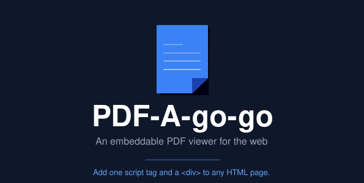

# PDF-A-go-go

[](https://github.com/khawkins98/PDF-A-go-go/actions)
[](LICENSE)

Embed a read-only PDF viewer in an HTML page with one stylesheet, one script and a
container. It provides search, zoom, selectable text, outline navigation and
shareable page links without a frontend framework.



[Try the demo](https://www.allaboutken.com/PDF-A-go-go/) · [All controls](https://www.allaboutken.com/PDF-A-go-go/kitchen-sink.html) · [Large-document demo](https://www.allaboutken.com/PDF-A-go-go/stress-test-large-pdf.html)

## Embed a PDF

Include the stylesheet and script, then point a container at your PDF:

```html
<link rel="stylesheet" href="https://khawkins98.github.io/PDF-A-go-go/pdf-a-go-go.css" />
<script defer src="https://khawkins98.github.io/PDF-A-go-go/pdf-a-go-go.js"></script>

<div class="pdfagogo-container" data-pdf-url="./your-document.pdf"></div>
```

Serve the page over HTTP(S). The PDF must be on the same origin or served with
CORS headers that allow your page to fetch it. The script initializes containers
automatically; no JavaScript setup is needed. For self-hosting, deploy the built
JS, CSS and worker together; see [hosting and CSP](EMBEDDING.md#hosting-and-content-security-policy).

## Configure the viewer

Use `data-*` attributes for the starting page, controls, themes and language.
[Embedding recipes](EMBEDDING.md) cover page links, dark themes, multiple viewers
and translation. German (`data-locale="de"`) is bundled; other languages can use
per-string overrides. The [configuration reference](DOCUMENTATION.md#configuration-options)
lists the options and defaults, and [the API reference](DOCUMENTATION.md#api-reference)
covers JavaScript integration.

## Limits

This is a read-only viewer: no annotations, form filling, password prompt,
thumbnail sidebar, rotation or print control. Outline navigation works for PDFs
with bookmarks; users can download the PDF to print it.

Use modern evergreen browsers. The automated browser suite targets Chromium;
validate your Firefox/Safari versions and mobile devices before deployment.
Restrictive hosts may need CSP changes, including inline styles; read the
[hosting recipe](EMBEDDING.md#hosting-and-content-security-policy) before adopting it.

## How it works

The viewer renders visible page tiles at the current zoom level and evicts cached
tiles through an LRU cache. Memory use depends on the document, viewport, zoom and
cache settings. [Architecture and API documentation](DOCUMENTATION.md) explains
the implementation; [the project story](https://www.allaboutken.com/posts/20250811-pdf-a-go-go/)
explains the motivation.

To reduce PDF transfer sizes before embedding, see the companion
[PDF-A-go-slim](https://github.com/khawkins98/PDF-A-go-slim).

## Development

```sh
yarn install
yarn dev       # Dev server on port 9000
yarn test      # Builds, starts a server and runs Playwright
```

See [Contributing](CONTRIBUTING.md) for setup, Git hooks and PR expectations.
[CLAUDE.md](CLAUDE.md) records source and build constraints. The complete
[build and deployment reference](DOCUMENTATION.md#build--deployment) describes the artifacts.

## Credits and license

Built on [PDF.js](https://github.com/mozilla/pdf.js) (Apache 2.0), with
[Lucide](https://lucide.dev) icons (MIT). PDF-A-go-go uses the [MIT license](LICENSE).
